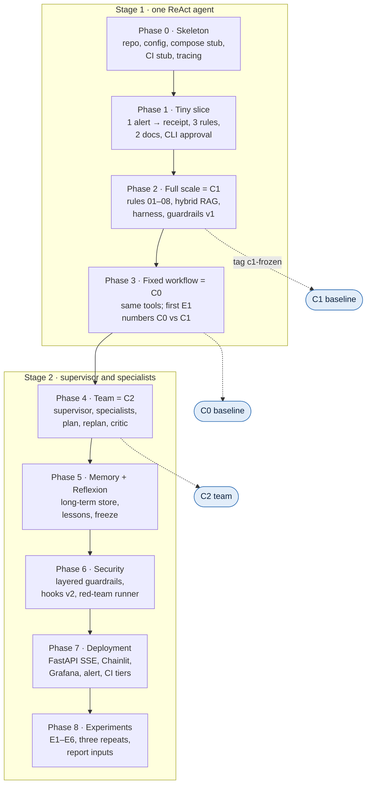

# 02 Build phases

**Strategy:** prove the whole loop with one agent on a tiny slice, then make it complete, then split it into a team. Each phase ends with an exit gate. Do not start a phase until the previous gate passes. Each phase lists what **not** to build yet. Don't build ahead, because that is how scope grows.

Each arrow is an exit gate: the next phase starts only when the previous phase's acceptance checks pass and a person ticks the gate in `PROGRESS.md`. The three rounded boxes are the experiment arms that E1 compares; they are three graphs over one set of tools.

Shared from Phase 1 onward, never forked: the four MCP servers, the Pydantic schemas, the rule engine, the approval code, the evaluation harness. C0, C1 and C2 are three graphs over the same tools.

---

## Phase 0: Skeleton (½ day)

**Goal:** an empty project that installs, lints, tests and starts.

Tasks
1. `pyproject.toml` (uv), package `auditguard`, ruff + mypy + pytest config, `Makefile` with the targets in `CLAUDE.md`.
2. `configs/base.yaml` and `auditguard/config.py` (typed settings, see `11_DEPLOYMENT_AND_CI.md` §1 and `13_MODEL_PROVIDERS.md` §2). Keep the provided `.env.example`; `.env` is git-ignored.
3. `auditguard/llm.py`: `get_model(role)` returns a `ChatOpenAI` built from the role's provider in config (default: local server at `http://127.0.0.1:8888/v1`), per `13_MODEL_PROVIDERS.md`. Add `scripts/llm_check.py` and `make llm-check`.
4. `infra/docker-compose.yml` with Postgres (two databases: `auditguard`, `groundtruth`), Qdrant. App services are added later.
5. `.github/workflows/ci.yml`: lint + tests on push.
6. `docs/PROGRESS.md` exists; first entry written.
7. Tracing wired in `llm.py` per `11_DEPLOYMENT_AND_CI.md` §7 (default backend LangSmith; confirm the choice in `PROGRESS.md`).
8. Makefile target `docs-evidence` (stub that the later scripts plug into).

Acceptance
- `uv sync && make lint && make test` pass on a clean clone.
- `docker compose up postgres qdrant` is healthy.
- `python -c "from auditguard.llm import get_model; print(get_model('specialist'))"` works (no call made).
- `make llm-check` passes for the local server (`Qwen3.5-9B-OptiQ-4bit` at `http://127.0.0.1:8888/v1`; Phase 0 was verified on `Qwen3.5-4B-4bit`): model listed, chat with thinking off, **tool calling** and **structured output** all work. These were verified by hand on 21 Nov 2026; if any fails now, stop and report.
- Setting `LLM_BASE_URL` in `.env` changes the endpoint with no code change.
- A single test model call appears in the tracing backend with a trace ID.

Do not build yet: any agent, MCP server, UI.

---

## Phase 1: Single agent, tiny slice (3–4 days)

**Goal:** one ReAct agent takes **one** synthetic alert from ingest to a mock receipt, with a human approval in the middle. Small but honest: real MCP servers, real rule code, real hash-bound approval.

Scope limits for this phase
- Ledger: 10 accounts, 60 days, generated with a fixed seed. Two typologies (rapid pass-through, fan-in) and one benign look-alike (payroll).
- Rules: **01 cash structuring, 04 rapid pass-through, 07 fan-in** only.
- Corpus: 2 documents, a handful of clauses each (PML Rules extract, KYC Directions extract). **BM25 only** for now.
- One agent, one prompt. CLI approval. SQLite checkpointer is fine in this phase.
- Model: the local `Qwen3.5-9B-OptiQ-4bit` (moved up from `Qwen3.5-4B-4bit` on 21 Nov 2026 after live runs, see `PROGRESS.md`). Record its tool-choice errors and structured-output retries in the mini evaluation; they decide whether any role needs a larger model.

Tasks
1. **Schemas** (`auditguard/schemas/`): `Alert`, `Transaction`, `LedgerSlice`, `DataQualityReport`, `RuleResult`, `Hypothesis`, `Passage`, `EvidencePack`, `DraftReport` (sentences with `evidence_ids`), `Payload`, `ApprovalRecord`, `Receipt`, `ToolError`. See `03_ARCHITECTURE.md` §3.
2. **Generator v0** (`data/generator/`): seeded; writes ledger tables to Postgres `auditguard` and labels to `groundtruth`. See `04_DATA_AND_RULES.md` §2.
3. **Rule engine v0**: rules 01, 04, 07 as pure functions + YAML + ≥5 unit tests each (fires, does not fire, boundary, empty, data defect).
4. **MCP servers v0** (FastMCP, stdio): `transactions` (get_transactions, get_account_summary, get_counterparty_flows), `aml_engine` (evaluate_rules, get_rule_metadata), `regulatory_kb` (search_passages BM25, get_passage), `filing_portal` (prepare_payload, submit_approved_payload, get_receipt) with its own SQLite. One happy-path and one error test per tool.
5. **Code nodes**: `ingest_validate` (calls transactions, returns `LedgerSlice` + `DataQualityReport`), `build_payload` (canonical JSON + SHA-256), `submit` (verifies approval, calls the portal).
6. **Single ReAct agent** (`agents/single.py`, `prompts/single_agent.md`): tools = the read and compute tools above. It returns one `SingleAgentResult` (indicators, hypotheses, passages and a `DraftReport`) as structured output, per `03_ARCHITECTURE.md` §2. It has **no** write tool.
7. **Graph** (`graph/single_agent.py`): `ingest_validate → agent → decision_gate (interrupt) → build_payload → approval_gate (interrupt) → submit → END`, and `decision_gate → close_no_file → END`. Checkpointer on. Diagram: `03_ARCHITECTURE.md` §2 (C1); the approval sequence is in `08_APPROVAL_GUARDRAILS_HOOKS.md` §2.
8. **CLI** (`make run-case CASE=...`): prints the plan-less trace, shows the payload and hash at the approval gate, accepts `approve | edit | reject`; `edit` opens the narrative in `$EDITOR`, recomputes the hash and requires a fresh approval.
9. **Evidence generators v1**: `scripts/gen_tool_catalogue.py` and `scripts/export_graphs.py` per `11_DEPLOYMENT_AND_CI.md` §8; commit `docs/tool_catalogue.md` and `docs/graph_c1.md`.
10. **Mini evaluation**: 6 development case scaffolds (2 per typology plus 2 payroll look-alikes). Role 1 fills in the expected outcomes. A script checks disposition, that every cited ID exists, and that every number in the draft equals a tool output.

Acceptance (exit gate)
- `make run-case CASE=ALR-SYN-0001` reaches a receipt after a CLI approval.
- Editing after approval makes `submit_approved_payload` return `STALE_HASH`.
- Killing the process at the decision gate and rerunning with the same `thread_id` resumes without re-running ingest.
- The mini evaluation runs on all 6 cases and prints a table; numbers-match = 100%.
- Grep proves no float is used for money and no model call computes an amount.
- Every run in the mini evaluation has a trace ID; `docs/tool_catalogue.md` lists all Phase 1 tools with schemas and their tests; `docs/graph_c1.md` shows the C1 graph.
- The mini-evaluation table includes, per case: tool calls, structured-output retries, invalid tool calls, latency and tokens.

Do not build yet: supervisor, specialists, critic, memory, Reflexion, guardrail models, UI, Docker services for the app.

---

## Phase 2: Single agent at full scale = C1 (4–5 days)

**Goal:** the single agent covers the full MUST scope and is measurable. When this phase ends, freeze it as **C1**.

Tasks
1. Generator v1: ≥300 background customers, typologies for rules 01–08 at controllable intensity, benign look-alikes (payroll, festival-season cash, seasonal business, rent), evasive variants, data defects (missing days, duplicates, reversals). Memo field carries injection test strings when the case asks for it.
2. Rules 02, 03, 05, 06, 08 with tests. Property tests (Hypothesis library) over ≥500 generated ledgers for every rule.
3. Add tools: `get_kyc_profile`, `get_linked_accounts`, `get_peer_baseline`, `get_prior_reports`, `search_typologies`, `list_document_versions`.
4. Retrieval v1: full corpus from `corpus/manifest.yaml`, clause-aware chunks, BM25 + bge vectors in Qdrant, RRF, cross-encoder reranker, query decomposition. 40 labelled queries (role 1 labels them). Recall@5 staircase script. See `07_RETRIEVAL.md`.
5. Postgres checkpointer; `thread_id = run_id`.
6. Approval v1: approval records in Postgres, requester ≠ approver, expiry, server-side verification, idempotency key. See `08_APPROVAL_GUARDRAILS_HOOKS.md`.
7. Guardrails v1: pseudonymisation before any model call; output checks (provenance complete, PII sentinels, no customer-facing text). Rule-based only in this phase.
8. Hooks v1: per-agent bearer token, allow-list, budget counter (tool calls, steps, tokens, seconds), post-tool log with cost.
9. Evaluation harness v1 (`eval/`): JSONL case loader, `HELDOUT_DIR` support (never read in development), code checkers, run records, results table. See `10_EVALUATION.md`.
10. Configs: `configs/experiments/c1_single.yaml`.

Acceptance (exit gate)
- All rule unit and property tests pass.
- Recall@5 staircase prints four rows; the reranker row beats vector-only.
- `make eval CONFIG=configs/experiments/c1_single.yaml SPLIT=dev` runs all dev cases and writes `runs/<run_id>/results.jsonl` with success, violations, cost, latency and errors.
- The ground-truth database is unreachable from every MCP server (negative test).
- Tag the commit `c1-frozen`.

Do not build yet: team, critic agent, memory, Reflexion, Llama Guard, UI.

---

## Phase 3: Fixed-workflow baseline = C0 (1–2 days)

**Goal:** a graph with **no agent decisions** over the same tools, so E1 can show what the agent adds.

Tasks
1. `graph/fixed_workflow.py`: ingest → evaluate all rules → one retrieval call per fired rule → one drafting call with a fixed template → decision and approval gates → submit.
2. `configs/experiments/c0_fixed.yaml`; export `docs/graph_c0.md`.
3. First E1 numbers on dev cases: C0 vs C1, same model, same budget.

Acceptance
- Both configs run through the same harness command.
- The results table shows where C0 wins as well as where it loses. Record it in the experiment log.

---

## Phase 4: Multi-agent team = C2 (5–6 days)

**Goal:** split the C1 job across a supervisor and specialists with typed hand-offs, a visible plan, replanning and a critic loop. **Same tools, same budget, same model family as C1.**

Tasks
1. `CaseState` v2 with plan, plan_version, hypotheses, passages, evidence pack, report versions, critic findings, budgets.
2. Supervisor + planner: emits a `Plan` object shown to the user; routes; replans on data gaps and on refuted hypotheses.
3. Investigator (ReAct): transactions + aml_engine + search_typologies. Returns `IndicatorSet` + ranked `HypothesisList`.
4. Regulatory Researcher (ReAct): runs **after** the first `IndicatorSet`; fans out one sub-query per fired rule and surviving hypothesis (LangGraph `Send`).
5. `assemble_evidence` code node and `resolve_evidence(ids)` local function.
6. Drafter (structured output): canonical case model with sentence-level evidence IDs.
7. Evidence Critic: code checks first, then judge; at most 2 revisions (self-correction loop).
8. Conditional edges exactly as in `03_ARCHITECTURE.md` §4.
9. Seed three replan cases: partial coverage, refuted first hypothesis, tool timeout.
10. `configs/experiments/c2_team.yaml` and `configs/experiments/c1_strong.yaml` (single agent on the supervisor's model); E1 on dev cases: C0 vs C1 vs C1-strong vs C2.
11. Export `docs/graph_c2.md` (with subgraphs) and regenerate the tool catalogue.

Acceptance
- A trace shows plan v1 → refuted hypothesis → plan v2 → recovery.
- The critic catches a planted wrong amount and the second draft passes.
- Kill-and-resume works mid-investigation.
- E1 dev table with C0, C1, C1-strong and C2.
- `docs/graph_c2.md` shows supervisor, specialists, the critic loop and both gates.

Do not build yet: memory, Reflexion, Llama Guard, UI polish.

---

## Phase 5: Memory and Reflexion (3–4 days)

Tasks
1. LangGraph store with namespaces `subject_history`, `facts`, `lessons` (see `09_MEMORY_AND_REFLEXION.md`). Delete command. Memory policy page.
2. Short-term trimming and running summary; evidence and approval state never summarised.
3. Reflexion runner on **dev cases only**: run → score with checkers (judge where code cannot) → reflection writes one lesson per failure → human review CLI (accept, edit, reject with reason) → playbook.
4. Lesson retrieval: at most 2 per case, similarity + applicability filter.
5. Freeze command: git tag + file hash of the playbook.
6. E6 config pair (memory off/on, playbook fixed) and E3 config pair (no playbook / frozen playbook).

Acceptance
- A stale-memory trap case does not let an old episode override current evidence.
- At least one rejected lesson with its reason is in the review log.
- `make freeze-playbook` writes the tag and hash.

---

## Phase 6: Security (2–3 days)

Tasks
1. Layered input guardrails: schema, pseudonymisation, Prompt Guard 2 on CPU, Llama Guard 4 (provider from config), scope policy.
2. Output guardrails v2: neutral wording, tipping-off check, PII sentinels.
3. Hooks v2: field allow-lists per agent, case-scope check, rogue-server protection (pinned server list, tool-description hashes).
4. Red-team **runner** that loads attacks from a folder (attacks are written by role 1), runs with defences off and on, and reports attack success and false blocks.
5. Threat model page from the template in `08_APPROVAL_GUARDRAILS_HOOKS.md` §6.

Acceptance
- E2 runs on the dev attack set with defences off and on.
- Every defence layer can be toggled from config.

---

## Phase 7: Deployment and operations (3 days)

Tasks
1. FastAPI: start case, stream events (SSE), resume with approval, health, `/metrics`.
2. Chainlit UI: triage queue, plan view, evidence view, decision and approval screens (approver identity ≠ requester).
3. All services in Compose: app, UI, 4 MCP servers over HTTP, Postgres, Qdrant, Prometheus, Grafana; Langfuse under a profile.
4. Grafana dashboard + one alert (repeated MCP failures).
5. CI tiers: push, pull-request replay smoke run, nightly live evaluation under a cost cap.

Acceptance
- `docker compose --profile llm up --build` on a clean machine (no oMLX, ideally not a Mac) brings everything up, `make llm-check` passes against the containerised server, and one case runs end to end; README steps work.
- On the development Mac, `docker compose up --build` uses the host oMLX server.
- Stopping an MCP server fires the alert.
- One deliberately failed CI run is kept with an explanation.

---

## Phase 8: Experiments and evidence (ongoing, last week)

Tasks
1. Judge calibration against ≥30 human-labelled drafts; Cohen's kappa overall and per criterion.
2. E1–E6 on held-out cases (role 1 mounts `HELDOUT_DIR`), three repeats, spread reported.
3. Export result tables for the evaluation report.

Acceptance
- Every row of the results template in `10_EVALUATION.md` §7 is filled from `runs/`.
