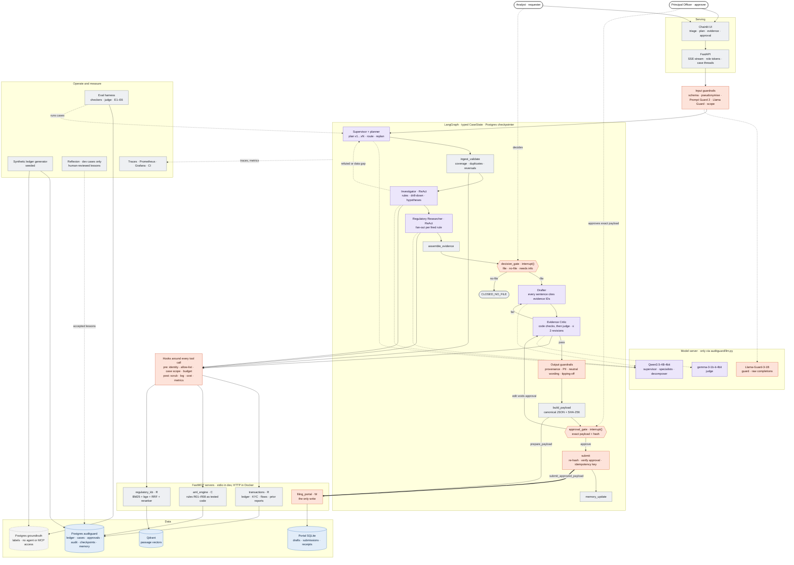
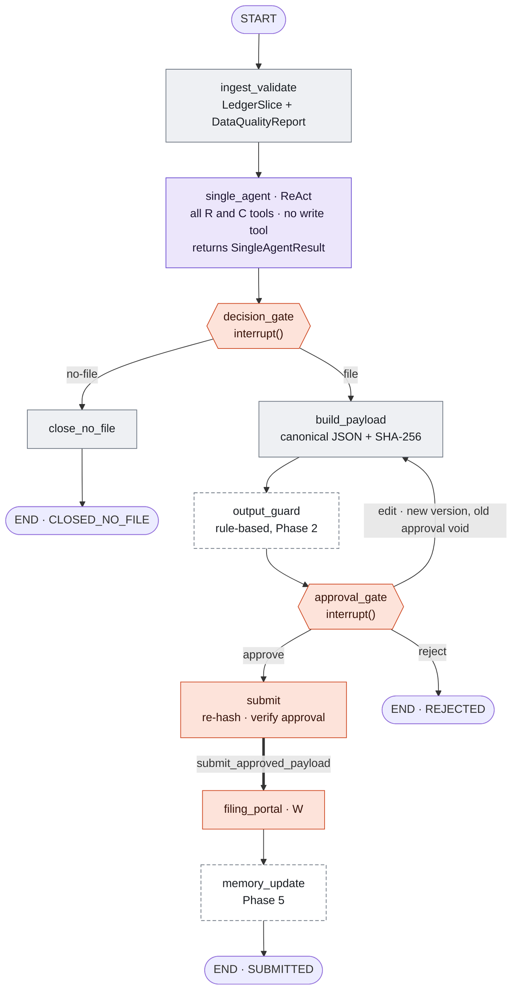
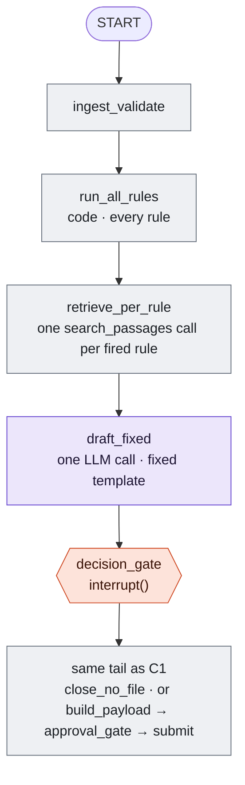
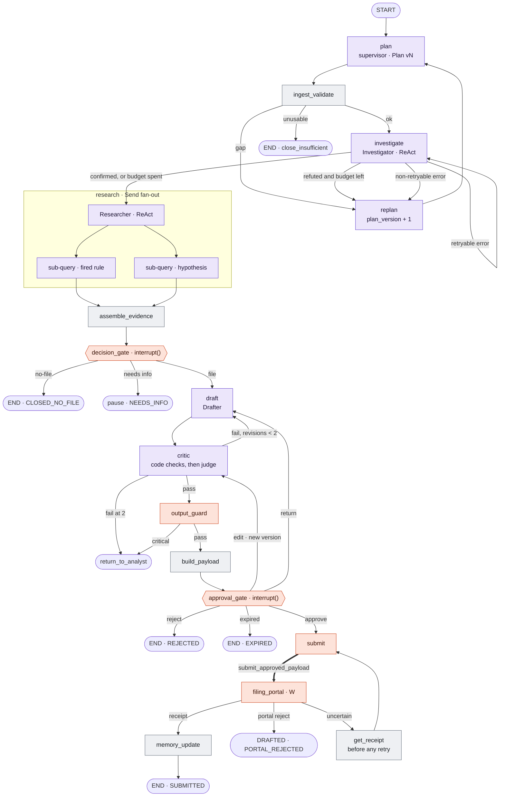
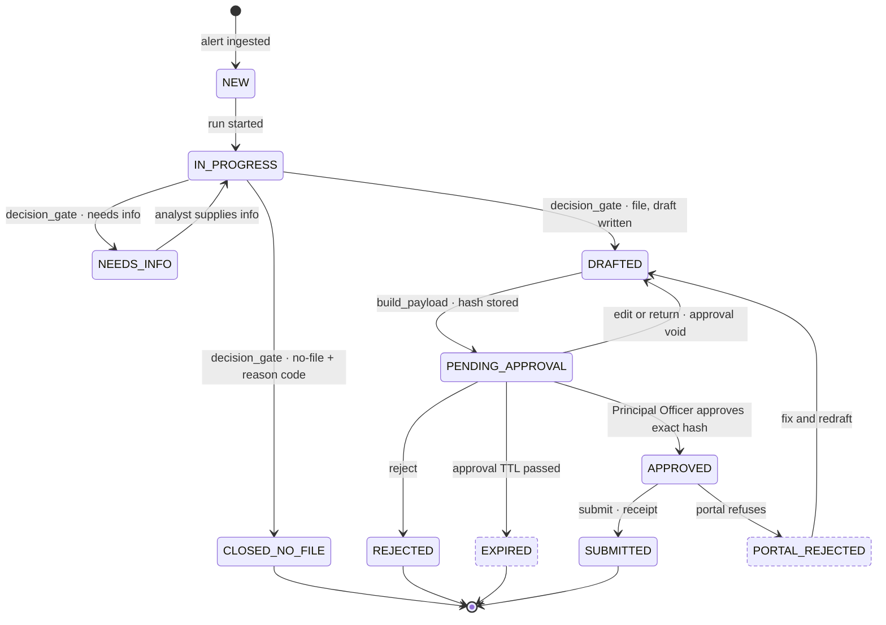

# 03 Architecture

## Reading the diagrams

All diagrams in these specs are Mermaid; they render on GitHub and in VS Code's Markdown preview. The same colours are used everywhere:

| Colour | Meaning |
|---|---|
| Purple | a model call (LLM). It proposes, it never decides a number |
| Coral | control: guardrails, hooks, the two `interrupt()` gates, and the only write path |
| Grey | plain, tested Python (code nodes, MCP servers, generator, harness) |
| Blue | a data store |
| Dashed grey | ground truth: no agent and no MCP server can reach it |
| Dashed outline | built in a later phase than the diagram's own |

A thick arrow (`==>`) is the one write to the outside world. A dotted arrow is a model call, a human input or a feedback route.

The graph diagrams below are the **specification**. From Phase 1, `scripts/export_graphs.py` also writes `docs/graph_c0.md`, `graph_c1.md` and `graph_c2.md` from the compiled LangGraph objects (`11_DEPLOYMENT_AND_CI.md` §8). If a generated diagram differs from one here, the code or this page is wrong; fix one of them.

## 1. Target architecture (Stage 2)



### Numbered walkthrough (one alert, end to end)

1. **Alert in.** The analyst opens an alert in the Chainlit UI. FastAPI starts a run (`case_id`, `run_id`) and streams every node event back over SSE.
2. **Input guardrails.** The alert and any user text are schema-checked and pseudonymised before any model sees them; Prompt Guard 2 and Llama Guard screen memos, counterparty names and user text; the scope policy refuses anything outside this case.
3. **Plan.** The supervisor writes plan v1 (a typed `Plan`, shown to the user).
4. **Ingest and validate (code).** `ingest_validate` reads the ledger through `transactions` and returns a `LedgerSlice` and a `DataQualityReport` (coverage, duplicates quarantined, reversals netted). A gap or an unusable ledger routes back to the planner or closes the case.
5. **Investigate (ReAct).** The Investigator calls `aml_engine.evaluate_rules` and drill-down tools. Every number comes from code; the model only ranks hypotheses. A refuted hypothesis or a data gap sends the case back to the planner (plan v2).
6. **Research (ReAct, fan-out).** The Researcher sends one sub-query per fired rule and surviving hypothesis to `regulatory_kb`, filtered by document version and date.
7. **Hooks on every tool call.** Before a tool runs, the pre-tool hook checks the agent's identity, the tool allow-list, the case scope and the budget. After it runs, the post-tool hook scrubs, logs and counts. The MCP servers check the agent token again on their side.
8. **Evidence and decision.** `assemble_evidence` builds the `EvidencePack`. `decision_gate` pauses with `interrupt()`: the **analyst** chooses file, no-file (with a reason code) or needs-info.
9. **Draft and critique.** The Drafter writes the report; every material sentence carries evidence IDs. The Critic runs code checks first (IDs resolve, every number equals a tool output), then the judge (a different model family). It allows at most two revisions.
10. **Output guardrails.** These check provenance, PII sentinels, neutral wording and tipping-off. A critical failure returns the case to the analyst.
11. **Payload and hash (code).** `build_payload` maps the report to the FIU-IND STR structure, serialises it as canonical JSON, hashes it with SHA-256 and stores the exact bytes through `filing_portal.prepare_payload`.
12. **Approval.** `approval_gate` pauses with `interrupt()`. The **Principal Officer** (never the requester) approves, edits, returns or rejects that exact payload and hash. Any edit creates a new version and voids the earlier approval.
13. **Submit (code, the only write).** `submit` re-hashes the stored payload, checks the HMAC-signed approval record, and calls `submit_approved_payload` with an idempotency key. The portal re-checks everything and returns a receipt or `STALE_HASH`.
14. **Remember and measure.** `memory_update` writes the subject history (Phase 5). Traces, Prometheus metrics and audit rows are kept for every run. The generator and evaluation harness are the only code that touches `groundtruth`.

Only `submit` (a code node) calls the only write tool, and only after `approval_gate`.

## 2. The three graphs (same tools, same schemas)

### C1: single agent (Phase 1–2)



`single_agent` returns one `SingleAgentResult { indicators, hypotheses, passages, draft }` as structured output. In Phase 1, `build_payload` connects straight to `approval_gate`; `output_guard` is added in Phase 2 and `memory_update` in Phase 5, without changing the other edges.

1. `ingest_validate` (code) reads the alerted account's ledger and checks data quality.
2. `single_agent` loops through the read and compute tools (ReAct) until it can return one structured result. It has no write tool, and its token cannot call one.
3. `decision_gate` pauses for the analyst. No-file closes the case with a reason code.
4. `build_payload` canonicalises and hashes the payload and stores it in the portal.
5. `approval_gate` pauses for the Principal Officer, showing the payload, its SHA-256 and the diff from the previous version. An edit loops back to step 4, which makes a new hash and voids every earlier approval.
6. `submit` re-hashes and verifies the approval, then makes the one write. A repeated submit returns the same receipt.

### C0: fixed workflow (Phase 3)



No model chooses a tool, a hypothesis or a route. The only model call writes the narrative from a fixed template; everything before it is a fixed sequence of the same tools C1 and C2 use.

### C2: team (Phase 4+)



1. **Plan, then ingest.** The supervisor writes plan v1; `ingest_validate` routes on the data-quality verdict: ok, gap (replan) or unusable (close as insufficient).
2. **Investigate.** The Investigator works until a hypothesis is confirmed or the budget is spent. A refuted hypothesis with budget left, or a non-retryable error, goes to `replan`, which bumps `plan_version` and returns to the supervisor. A retryable error is retried (reads only, at most twice, per `08` §5).
3. **Research.** One `Send` per fired rule and surviving hypothesis; the results join at `assemble_evidence`.
4. **Decide.** As in C1, plus needs-info, which pauses the case in `NEEDS_INFO`.
5. **Draft ↔ critic.** This is the self-correction loop, with at most two revisions; after the second failure the case goes back to the analyst.
6. **Guard, payload, approval.** An edit at the approval gate goes back through the critic (a new version and a new hash); return sends it to the drafter; an approval that expires is never treated as approved.
7. **Submit.** A receipt goes on to `memory_update`. A portal rejection puts the case back in DRAFTED. An uncertain result (a timeout) calls `get_receipt` before any retry, so nothing is filed twice.

## 3. Core schemas (Pydantic v2, `auditguard/schemas/`)

All hand-offs inherit:

```python
class HandOff(BaseModel):
    case_id: str
    run_id: str
    schema_version: str = "1"
    status: Literal["ok", "partial", "error"]
    evidence_refs: list[str] = []
    error: ToolError | None = None
```

| Model | Key fields |
|---|---|
| `Alert` | alert_id, account_ref, scenario_code, detected_at (UTC), profile="IN" |
| `Transaction` | txn_id, account_token, ts (UTC), amount (Decimal), direction, channel, counterparty_token, memo_ref |
| `LedgerSlice` | account_tokens, from_date, to_date, txn_count, ref (storage key, not the rows) |
| `DataQualityReport` | coverage_ratio, missing_days, duplicates_quarantined, reversals_netted, verdict (ok, gap, unusable) |
| `RuleResult` | rule_id, version, fired, score, inputs, threshold, supporting_txn_ids, explanation_template_id |
| `Hypothesis` | hyp_id, label, kind (suspicious, benign), status (open, confirmed, refuted), evidence_ids, reason |
| `Passage` | passage_id, doc_id, version, clause_ref, effective_from, text, score |
| `Plan` | plan_version, steps[{step_id, name, depends_on, budget}], reason |
| `EvidencePack` | indicators, hypotheses, passages, coverage note |
| `Decision` | decision (file, no_file, needs_info), reason_code, rationale, decided_by |
| `DraftSentence` | text, evidence_ids (≥1 for material claims) |
| `DraftReport` | version, sections{introduction, body, grounds, close}: list[DraftSentence] |
| `CriticReport` | code_checks[{check, passed, detail}], judge{claim_support, tone}, verdict |
| `Payload` | report_version, canonical_json, sha256 |
| `ApprovalRecord` | approval_id, case_id, payload_sha256, report_version, approver_id, role, decision, expires_at, hmac |
| `Receipt` | ack_id, case_id, payload_sha256, ts |
| `ToolError` | error_code, message, retryable, tool_name, correlation_id |

## 4. CaseState (LangGraph state)

```python
class CaseState(TypedDict):
    case_id: str; run_id: str; alert: Alert
    plan: Plan | None
    ledger: LedgerSlice | None; data_quality: DataQualityReport | None
    indicators: list[RuleResult]; hypotheses: list[Hypothesis]; passages: list[Passage]
    evidence: EvidencePack | None; decision: Decision | None
    drafts: list[DraftReport]; critic: list[CriticReport]; revisions: int
    payload: Payload | None; approval: ApprovalRecord | None; receipt: Receipt | None
    budgets: Budgets            # steps, tool_calls, tokens, seconds: used and limit
    errors: list[ToolError]
    messages: Annotated[list, add_messages]   # trimmed; never the only copy of evidence
```

Rules: evidence, plan versions and approval state live in typed fields, never only in `messages`. Nodes before an `interrupt()` must be idempotent, because LangGraph re-runs the interrupted node from its start on resume.

## 5. Case lifecycle (Postgres `cases` table)

MUST states: NEW, IN_PROGRESS, NEEDS_INFO, DRAFTED, PENDING_APPROVAL, APPROVED, SUBMITTED, CLOSED_NO_FILE, REJECTED. SHOULD: EXPIRED, PORTAL_REJECTED. A transition table in code; illegal transitions raise and are audited.

The diagram shows the transitions the graph routes in §2 imply. The transition table in code is the authority; if the two disagree, raise it in `PROGRESS.md`. Dashed states are SHOULD.



## 6. Who decides what

| Model | Code | Person |
|---|---|---|
| Plan and routing; which hypotheses and drill-downs; which passages; narrative wording; semantic claim check | Indicators, sums, windows, thresholds; data quality; payload mapping and hash; permissions; budgets; approval verification; submission | File or no-file; approve, edit or reject the exact payload; accept lessons |
