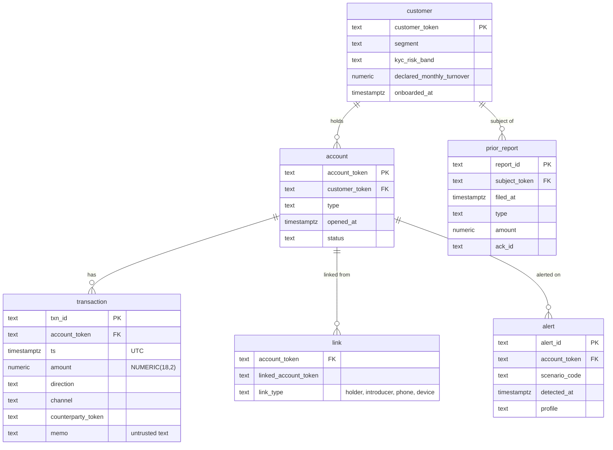
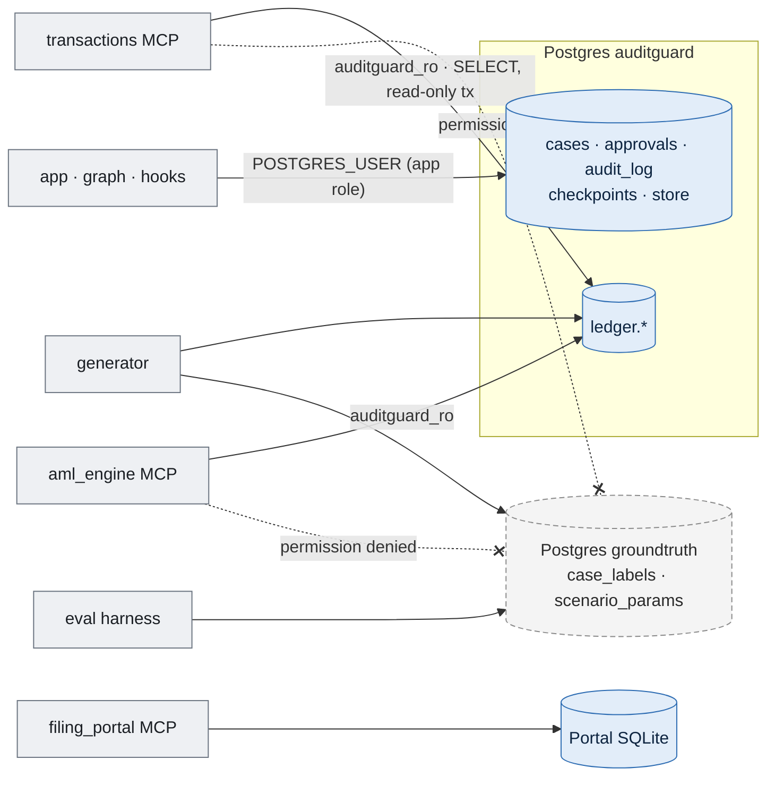

# 04 Data and rules

## 1. Databases

| Database | Contents | Who connects |
|---|---|---|
| Postgres `auditguard` | customer, entity_party, account, transaction, link, alert, prior_report, cases, approvals, audit_log, checkpoints, store | App and MCP servers (separate DB roles: transactions and aml_engine connect as `auditguard_ro`, SELECT only on ledger tables, read-only transactions) |
| Postgres `groundtruth` | case_labels, scenario_params | Evaluation harness and generator only. **No MCP server, no agent.** Separate user and password |
| Portal SQLite (`filing_portal.db_path`, default `var/portal.db`) | drafts, submissions, receipts | filing_portal server only |

Ledger tables (minimum columns). Money columns are `NUMERIC`, never float; `ts` is `TIMESTAMPTZ` stored in UTC.



Who can reach which database:



`memo` is untrusted text and is used for injection tests.

## 2. Synthetic ledger generator (`data/generator/`)

- Deterministic given `--seed`. Writes ledger tables to `auditguard` and labels to `groundtruth`.
- Inputs: `typology_spec.yaml` (written by role 1) and a scale profile (`tiny` for Phase 1, `full` for Phase 2+).
- Background: ≥300 customers for `full` (10 for `tiny`), realistic channel mix (UPI, NEFT, IMPS, cash, card), salary days, festival spikes.
  Built: `full` = 320 customers over 182 days ending 2026-03-31, each variant planted 4 times in random slots. Background v1 (`data/generator/background.py`) is calibrated in `data/generator/background_IN.yaml`, which cites its sources (RBI Payment System Indicators and Bulletin, Worldline, IIMB) next to each ticket size. `tiny` keeps the simple v0 background and is unchanged.
- Injection: each typology at a controllable intensity; benign look-alikes; evasive variants (amounts jittered just outside a boundary, spread over a longer window); data defects (missing days, duplicates, reversals).
- Names from `names_fictional.txt`, checked against a deny-list. IDs look like `ACCT-SYN-000123`, `CUST-SYN-000045`, `TXN-SYN-0000001`.
- Output: `alert` rows for each planted scenario and for noise alerts.

`typology_spec.yaml` entry format (Claude Code drafts the schema and one example; role 1 writes the rest):

```yaml
- scenario_family: rapid_pass_through
  description: credits leave within hours, balance near zero
  parameters: {inflow_count: [8, 25], hold_hours: [2, 40], share_out: [0.85, 0.99]}
  variants: [standard, evasive_slow, benign_lookalike_payroll]
  expected_disposition: escalate_for_review   # benign variant: no_action
```

## 3. Rule spec (role 2 owns this section with the domain reviewer)

Each rule: `rules/IN/<rule_id>.yaml` + a pure function in `mcp_servers/aml_engine/engine/rules/r<id>.py` + `tests/rules/test_r<id>.py` (≥5 tests: fires, does not fire, boundary, empty data, data defect) + property tests from Phase 2.

YAML format:

```yaml
rule_id: R04
name: rapid_pass_through
version: 1.0.0
source_tag: project_heuristic        # legal_requirement | institutional_policy | project_heuristic
effective_from: 2026-01-01
parameters: {share_out_min: "0.90", hold_hours_max: 48, residual_balance_max: "1000.00"}
linked_passage_ids: []               # filled after ingestion
benign_counter_check: verified_payroll_employer
explanation_template_id: R04_v1
```

Rule function signature:

```python
def evaluate(ledger: list[Transaction], kyc: KycProfile, params: R04Params, tz: ZoneInfo) -> RuleResult: ...
```

Pure: no I/O, no clock, no randomness. Thresholds only from params. `Decimal` everywhere.

| Rule | Typology | Logic | Default (IN) | Phase |
|---|---|---|---|---|
| R01 | Cash structuring | ≥ N cash deposits each in [L, T) within W days | T from PML Rules (source must be tagged before use; placeholder 1000000.00 in config), L = 0.8T, N = 3, W = 30 | 1 |
| R02 | Integrally connected cash | Calendar-month sum of related cash ≥ T while each < T | Asia/Kolkata months | 2 |
| R03 | Velocity spike | Count or value in 7 days > k × customer p90 | k = 3 | 2 |
| R04 | Rapid pass-through | ≥ P% of credits debited within H hours, residual near zero | P = 90, H = 48 | 1 |
| R05 | Dormant reactivation | No activity D days, then value > V within 30 days | D = 365, V = 5 × last-year median | 2 |
| R06 | Profile mismatch | Monthly turnover > m × declared | m = 3 | 2 |
| R07 | Fan-in | ≥ S distinct senders in W days | S = 20, W = 7 | 1 |
| R08 | Fan-out | ≥ R distinct beneficiaries in W days | R = 20, W = 7 | 2 |
| R09–R12 | Circular flow, linked accounts, high-risk geography, round amounts | see proposal | — | SHOULD |

A fired rule is an indicator, never a filing decision. Mixed currency is a data-quality error, not a rule input.

## 4. Independence

Role 2 and Claude Code implement rules from this section only. Never read `groundtruth`, generator parameters for a specific case, or case labels when writing rule code.
