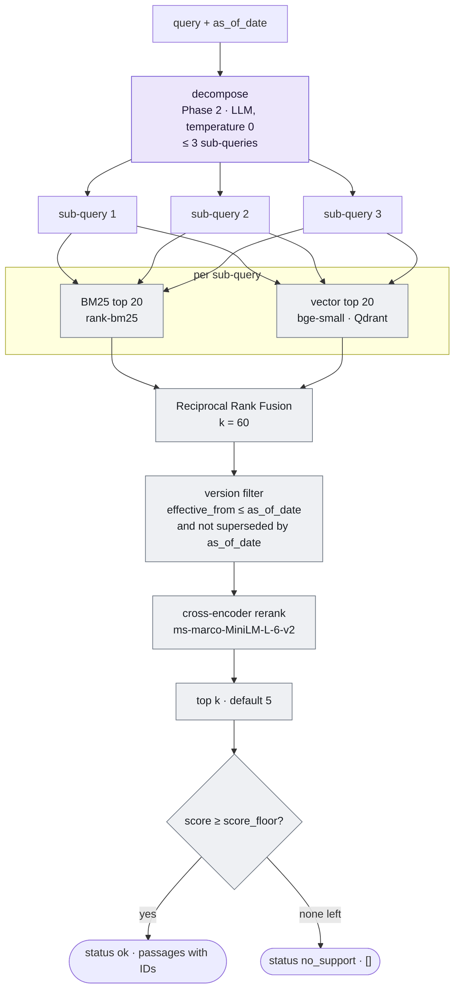

# 07 Retrieval

## Corpus manifest (`corpus/manifest.yaml`)

Corpus files are **fetched by script**, not committed, unless redistribution is clearly allowed.

```yaml
- doc_id: RBI-KYC-CB-2025
  title: Reserve Bank of India (Commercial Banks - Know Your Customer) Directions, 2025
  issuer: RBI
  reference: RBI/DOR/2025-26/169
  version: "2025-12-29"
  published: 2025-11-28
  effective_from: <confirm with domain reviewer>
  superseded_by: null
  url: <official URL>
  licence_note: <check>
  sha256: <filled by fetch script>
- doc_id: RBI-KYC-MD-2016
  title: Master Direction - KYC, 2016 (superseded; kept to test version filtering)
  superseded_by: RBI-KYC-CB-2025
  ...
- doc_id: PML-RULES-2005
- doc_id: PMLA-2002-S12
- doc_id: FIU-IND-STR-GUIDANCE
- doc_id: TYPOLOGY-*          # public typology material only (FATF reports; FIU-IND material confirmed public)
```

Phase 1 uses two documents with a few clauses each. The domain reviewer signs the manifest.

## Ingestion (`scripts/ingest.py`)

1. Fetch each URL, verify or record `sha256`, store under `corpus/raw/` (git-ignored).
2. Parse PDF or HTML to text, keeping clause numbers (e.g. "Rule 8(2)").
3. Clause-aware chunking: one chunk per numbered clause; split long clauses at sub-clauses; keep tables as text tables.
4. Passage ID: `{doc_id}:{clause_ref}:{version}`, stable across runs.
5. Metadata per chunk: doc_id, title, issuer, version, published, effective_from, superseded_by, clause_ref, kind (`regulation` | `typology`).
6. Index: BM25 (`rank-bm25`, pickled per corpus version) and dense vectors (`BAAI/bge-small-en-v1.5`, CPU) in Qdrant collection `passages_<corpus_version>`.

## Search (`regulatory_kb.search_passages`)



Phase 1 runs only the BM25 branch, the version filter and the score floor (no decomposition, vectors, fusion or reranker). Each later step is one row of the Recall@5 staircase (E5), so its effect is measured on its own.

Version preference is a metadata filter, not a prompt instruction. Retrieved text is returned inside a `Passage` model and wrapped in a data block by the caller.

## Labelled queries (`eval/retrieval/queries.jsonl`, labelled by role 1)

40 queries in four types (rule provenance, typology, procedure, definition), 10 each:

```json
{"qid": "Q001", "type": "rule_provenance", "query": "time limit to furnish a suspicious transaction report", "as_of": "2026-06-01", "relevant": ["PML-RULES-2005:8(2):…"]}
```

## E5 staircase (`make retrieval-eval`)

| Arm | Config |
|---|---|
| vector only | `retrieval: {bm25: false, rerank: false, decompose: false}` |
| + BM25 with RRF | `bm25: true` |
| + reranker | `rerank: true` |
| + decomposition | `decompose: true` |

Report Recall@5, MRR and "in-force version ranked first" for each arm. The Recall@5 of the agreed baseline becomes a CI gate.
