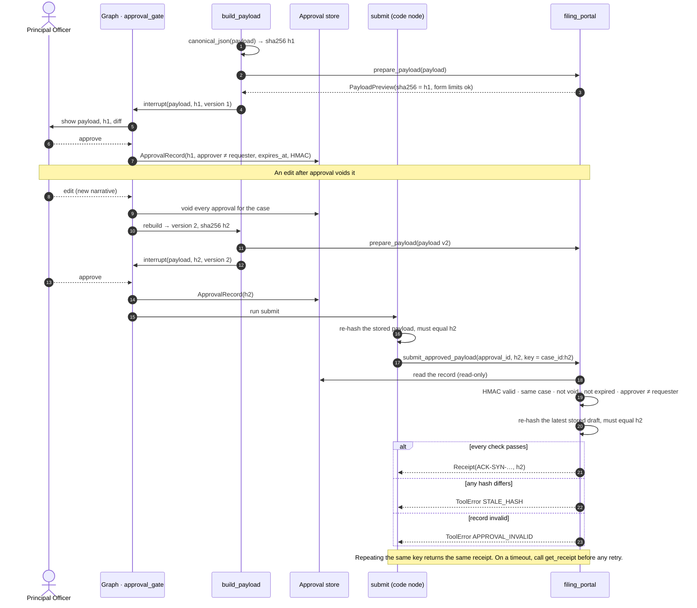

# 08 Approval, guardrails and hooks

## 1. Canonical payload and hash (`auditguard/approval/canonical.py`)

```python
def canonical_json(payload: dict) -> bytes:
    # sorted keys, no insignificant whitespace, Decimals as strings,
    # datetimes as UTC ISO 8601 with 'Z', UTF-8, NFC-normalised strings
def payload_hash(payload: dict) -> str:  # hex SHA-256 of canonical_json
```

Tests: key order does not change the hash; `Decimal("10.0")` vs `Decimal("10.00")` is normalised by the payload schema, not by luck; any field change changes the hash.

The payload follows the FIU-IND bank STR structure (report details, Principal Officer, branch, subjects, accounts, reason codes, grounds of suspicion, action taken). It never contains ground truth, risk scores or model names. Reason codes come from fired rules through `configs/reason_codes.yaml`; the analyst confirms them.

## 2. Gates (`auditguard/graph/gates.py`)

**decision_gate**: `interrupt({"kind": "decision", "evidence_pack": ..., "options": ["file", "no_file", "needs_info"]})`. Resume value: `Decision`. No-file needs a reason code and rationale.

**approval_gate**: `interrupt({"kind": "approval", "payload": canonical, "sha256": h, "report_version": v, "diff": diff_from_previous})`. Resume value: `{"action": "approve" | "edit" | "return" | "reject", "approver_id", "edited_payload"?}`.

- `approve`: write `ApprovalRecord` (approval_id, payload_sha256, report_version, approver_id, role, decision, expires_at = now + `approval.ttl_minutes`, hmac over these fields with `APPROVAL_HMAC_KEY`). Refuse if approver_id == requester_id.
- `edit`: create report version v+1, mark previous approvals void, route back through critic and output guardrails, recompute hash.
- Expiry never counts as approval.

**submit** (code node): recompute hash from stored payload → must equal approval's hash → call `submit_approved_payload` with an idempotency key `f"{case_id}:{sha256}"`. On timeout or uncertain result, call `get_receipt` before any retry. Never retry blindly.

Nodes before an interrupt are idempotent (resume re-runs the interrupted node from its start).

### Approval and submit, step by step

The sequence shows one approval, one edit that voids it, and the second approval that is submitted. The portal's own checks are the server-side half of rule 3: the graph checks first, then the portal checks again and refuses on its own.



## 3. Input guardrails (`auditguard/guardrails/input.py`)

Order, each layer toggled in config (`guardrails.input.*`), all logged:
1. Schema validation of the alert and any user text.
2. Pseudonymisation (`pseudonymise.py`): replace account numbers, names, phone numbers, PAN-like and Aadhaar-like patterns with tokens; mapping stored in a separate encrypted table, never in prompts or traces. Phase 1.
3. Prompt Guard 2 (CPU) on memos, counterparty names and user text. Phase 6.
4. Llama Guard on user-entered text: local Llama Guard 3 1B in `completions_raw` mode by default; Llama Guard 4 on OpenRouter is the config alternative (see `13_MODEL_PROVIDERS.md` §1b). Phase 6.
5. Scope policy: request must be about the alert's case; otherwise refuse.

## 4. Output guardrails (`auditguard/guardrails/output.py`)

- Provenance: every material sentence has ≥1 evidence ID that resolves.
- PII sentinels: no raw identifier pattern, no de-pseudonymised value.
- Neutral wording: no accusation verbs from a deny-list; prefer "indicator observed", "requires review".
- No customer-facing or tipping-off content; there is no outbound customer channel anywhere in the code.
- A critical failure blocks the approval gate and returns the case to the analyst.

## 5. Hooks (`auditguard/hooks/`)

Wrap every MCP tool call (including inside ReAct agents):

**pre_tool**: agent identity → tool on the agent's allow-list → case scope → input schema → per-agent field allow-list (Phase 6) → budget check (tool calls, steps, tokens, seconds, cost cap). Deny returns `ToolError(FORBIDDEN | BUDGET_EXCEEDED)` to the agent; it never raises.

**post_tool**: scrub PII from the logged copy, log tool, args hash, latency, result size, cost, error code; increment Prometheus counters; append to `audit_log`.

Retry policy: reads only, with exponential backoff, only when `retryable=True`, max 2.

## 6. Threat model page template (`docs/threat_model.md`, Phase 6)

Sections: assets · trust boundaries · actors · goals · STRIDE table (boundary, threat, example, control, test) · defence layers · red-team composition (36 attacks: direct injection 4, memo/counterparty injection 6, poisoned passage 4, rogue tool description 3, over-privilege/unauthorised write 5, approval replay/tamper/self-approval 5, cross-subject memory 3, PII leakage 3, tipping-off 2, suppress/fabricate indicator 1) · out of scope. Attacks are written by role 1; Claude Code builds only the runner.
