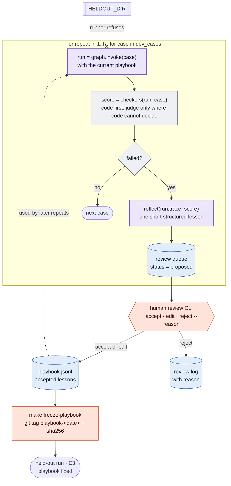

# 09 Memory and Reflexion (Phase 5)

## Short-term

- Postgres checkpointer after every node; `thread_id = run_id`.
- `messages` trimmed to the last `memory.short_term.keep_turns` (default 12) plus a running summary node. Typed state fields (evidence, plan versions, approval) are never trimmed or summarised.
- Agents read large ledgers only through aggregate tools.

## Long-term: one LangGraph store (`auditguard/memory/store.py`), Postgres-backed

| Namespace | Value schema | Written when | Read by | Correct / delete |
|---|---|---|---|---|
| `("subject_history", subject_token)` | case_id, outcome, indicators fired, disposition, report_version, decided_at | `memory_update` node, after the final human decision | supervisor, investigator, only when the current case's subject matches | `memory supersede|withdraw|delete <key> --reason` |
| `("facts", subject_token)` | fact, source_case, confirmed_by, expires_at | Analyst confirms a fact in the UI or CLI | investigator | expired facts never returned; edit or delete |
| `("lessons", agent_name)` | lesson_id, trigger, instruction, when_not_to_apply, source_dev_case, status, reviewer, reason | Reflexion review CLI, after human approval | investigator, drafter: ≤2 per case | edit, supersede, withdraw with audit reason |

Rules
- Untrusted text (memos, passages) can never be written to memory.
- Lessons cannot change thresholds, permissions or rule outputs; a validator rejects any lesson whose instruction mentions a threshold, a rule parameter or a tool permission.
- Dedupe on write; timestamp; every write and delete goes to `audit_log`.
- Prior regulatory reports are **not** memory: they are records served by `transactions.get_prior_reports`.
- Memory is toggled in config (`memory.long_term.enabled`) for E6.

## Reflexion (`auditguard/reflexion/`)

Runs on **development cases only** (the runner refuses any path under `HELDOUT_DIR`).



Lesson schema:

```json
{"lesson_id": "L007", "agent": "investigator", "trigger": "inflows on salary dates from one employer",
 "instruction": "check get_counterparty_flows for a single employer before ranking pass-through first",
 "when_not_to_apply": "employer not verified in facts", "source_dev_case": "DEV-014",
 "status": "accepted", "reviewer": "<id>", "reason": "matches 3 failures"}
```

Retrieval at run time: embed the case summary, take top lessons by similarity, keep those whose `trigger` matches and `when_not_to_apply` does not, max 2. Record which lessons were used in the run record.

Outputs for the report: lessons proposed/accepted/edited/rejected, one rejected lesson with reason, lesson-generation cost, E3 before/after on held-out, any lesson that made results worse (ablate each accepted lesson on dev if time allows).

## E6 memory comparison

- Cases: 14 repeat-subject cases, each linked to a prior case in the same split, plus one stale-memory trap (an old episode whose conclusion no longer applies).
- Arms: `configs/experiments/e6_memory_off.yaml`, `e6_memory_on.yaml`. Playbook fixed (same frozen playbook or none in both).
- Measures: repeat-pattern accuracy, redundant tool calls, report completeness, trap passed.
