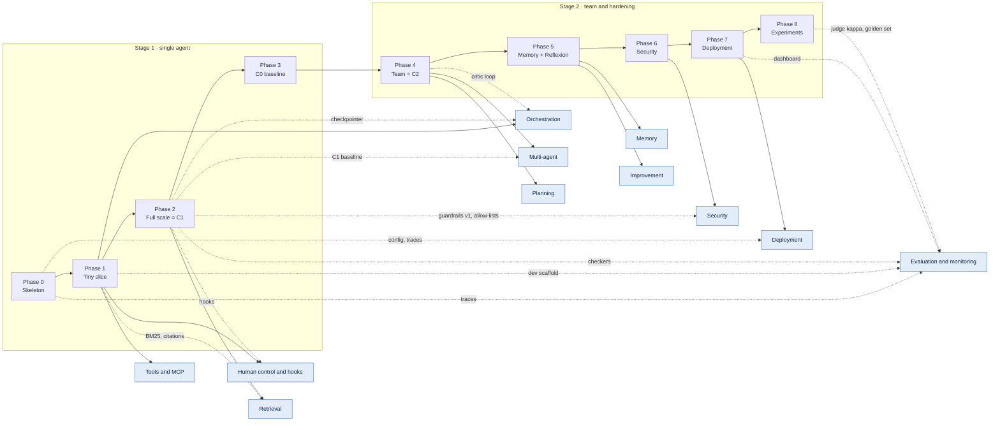

# 14 Minimum-bar checklist

Every row of the minimum bar in the course guide (GenAI Capstone guide, 24 October 2026, page 3), split into checkable items. For each: the phase that builds it, the evidence shown at the final review, and the role that owns it. Tick items as phases finish; the final review needs every box ticked.

## Where each area is built

Each box is one area of the minimum bar. An arrow means "first built in, completed in". Read it with the phase roadmap in `02_BUILD_PHASES.md`.

## Retrieval (role 2)

- [ ] Ingested passages keep source and date metadata (doc_id, version, published, effective_from, superseded_by). Phase 2 · `07_RETRIEVAL.md`
- [ ] Hybrid search: BM25 + vectors combined with Reciprocal Rank Fusion. Phase 2
- [ ] Cross-encoder reranker. Phase 2
- [ ] One query-side technique: query decomposition. Phase 2
- [ ] Answers cite passage IDs (Drafter sentences carry them; Critic resolves them). Phase 1 (BM25), Phase 4
- [ ] **Evidence:** Recall@5 on 40 labelled queries, before and after one change (E5 staircase). `make retrieval-eval` → results table

## Tools and MCP (role 2)

- [ ] ≥3 FastMCP servers (we have 4: transactions, aml_engine, regulatory_kb, filing_portal). Phase 1
- [ ] Typed inputs and outputs (Pydantic). Phase 1
- [ ] Errors returned as structured `ToolError`, never crashes. Phase 1
- [ ] Every tool labelled read, compute or write. Phase 1
- [ ] Write access only where needed: only the `submit` node holds the filing-portal token. Phase 1 (viva: the guide's "action agent" is a code node here because payload mapping is deterministic, rule 1)
- [ ] **Evidence:** `docs/tool_catalogue.md` (generated, schemas included) and one test per tool (the generator fails if a tool has no test). `make docs-evidence`

## Orchestration (role 3)

- [ ] LangGraph graph with typed state (`CaseState`). Phase 1
- [ ] Conditional edges (decision gate, approval gate; replan, critic and data-quality routing in C2). Phase 1, Phase 4
- [ ] One self-correction loop (Drafter ↔ Critic, ≤2 revisions). Phase 4
- [ ] Persistent checkpointer (Postgres). Phase 2
- [ ] **Evidence:** graph diagrams `docs/graph_c1.md`, `docs/graph_c2.md` (generated); live demo: kill mid-run and resume

## Memory (role 2)

- [ ] Short-term context trimmed or summarised. Phase 5
- [ ] One long-term store (LangGraph store: subject_history, facts, lessons). Phase 5
- [ ] Written policy: what is saved, when, who can read it, how it is corrected or deleted. Phase 5
- [ ] **Evidence:** one-page `docs/memory_policy.md`; memory on vs off comparison (E6)

## Planning (role 3)

- [ ] Plan object shown to the user (`Plan`, versioned, in the UI and CLI). Phase 4
- [ ] Replan when a tool result contradicts the plan (three seeded replan cases). Phase 4
- [ ] ReAct within the specialists (Investigator, Researcher). Phase 4
- [ ] **Evidence:** a trace showing plan v1 → contradiction → plan v2

## Multi-agent (role 3)

- [ ] Supervisor + ≥3 specialists, each with its own tools (Investigator, Researcher, Drafter, Critic). Phase 4
- [ ] Typed hand-off message between every pair (Pydantic `HandOff`). Phase 4
- [ ] Single-agent baseline with the same tools and budget (C1, frozen at tag `c1-frozen`). Phase 2
- [ ] **Evidence:** E1 table: C0, C1, C1-strong, C2 (success, violations, cost, latency, errors)

## Improvement (role 3; human reviewer)

- [ ] Reflexion loop run on development cases only. Phase 5
- [ ] Each run scored by checker code; judge only where code cannot decide. Phase 5
- [ ] Reflection step turns each failure into a short lesson that states when it applies. Phase 5
- [ ] A person reviews every lesson before it enters the playbook. Phase 5
- [ ] Only lessons relevant to the case are retrieved (≤2). Phase 5
- [ ] Playbook frozen (git tag + hash) before the held-out run. Phase 5
- [ ] **Evidence:** held-out results before and after the playbook (E3); the playbook file; one rejected lesson with its reason

## Evaluation and monitoring (role 1; dashboard role 4)

- [ ] Golden set of ≥60 cases (72: 24 dev, 48 held-out), expected outcomes written before runs. Phase 1 (scaffold) → Phase 8
- [ ] Checks on outcomes, trajectories and tool use (checkers in `10_EVALUATION.md` §4). Phase 2
- [ ] LLM judge from a different model family (not Qwen) checked against ≥20 human labels (we use 30; Cohen's kappa). Phase 8
- [ ] Traces kept for every run (tracing on by default; a run without a trace ID fails). Phase 0 onward
- [ ] Grafana dashboard. Phase 7
- [ ] **Evidence:** evaluation report (4–6 pages), judge agreement table, dashboard

## Human control and hooks (role 4)

- [ ] Every action that changes the world goes through `interrupt()` with approve, edit and reject. Phase 1
- [ ] Approval tied to the exact payload (SHA-256 of canonical JSON). Phase 1
- [ ] Pre-tool hooks enforce permissions and budget. Phase 2
- [ ] Post-tool hooks log. Phase 2
- [ ] **Evidence:** live demo: an edit invalidates an earlier approval (`STALE_HASH`)

## Security (role 4 builds defences; role 1 writes attacks)

- [ ] One-page threat model (`docs/threat_model.md`). Phase 6
- [ ] Input and output guardrails (layered). Phase 2 (rule-based), Phase 6 (models)
- [ ] Each agent has only the tools it needs (allow-lists + tokens). Phase 2
- [ ] Red-team suite of ≥30 attacks (36), including injection through our own data path (transaction memos, counterparty names). Phase 6
- [ ] **Evidence:** attack success with defences off and on, and the false-block rate on clean cases (E2)

## Deployment (role 4)

- [ ] FastAPI with streaming (SSE). Phase 7
- [ ] `docker compose up` starts the app, MCP servers, vector store, Prometheus and Grafana. Phase 7
- [ ] Prompts and model IDs in one versioned config (`configs/base.yaml`). Phase 0
- [ ] Evaluation runs in CI and fails below a threshold. Phase 7
- [ ] One working alert (repeated MCP failures). Phase 7
- [ ] **Evidence:** installation on a clean machine (`docker compose --profile llm up --build`, no oMLX needed) and one failed CI run with an explanation

## Beyond the minimum bar (also required by the guide)

- [ ] Both signature challenges done properly (A: auditable numbers and narrative; B: hypothesis-driven investigation under a budget)
- [ ] Experiments E1–E4 from one harness, one config per arm; E4 = the agreed signature ablation
- [ ] Final held-out comparison repeated three times, spread reported
- [ ] Separations: role 3 writes no held-out cases; role 4 writes no attacks
- [ ] Submission: README with one-command start, redrawn architecture + numbered walkthrough, threat model, memory policy, evaluation report, experiment log, contribution log, slides, backup demo recording
