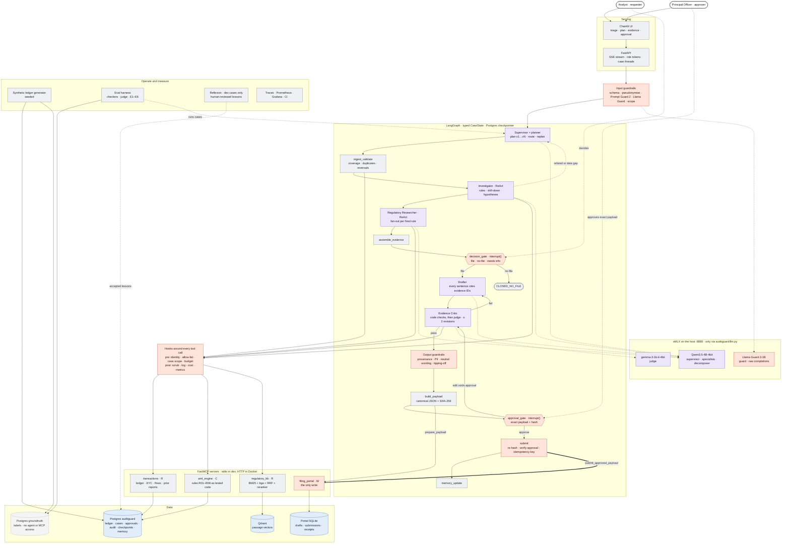

# AuditGuard architecture diagrams

Mermaid source for the system diagram (Stage 2 target, `03_ARCHITECTURE.md` §1) and the C1 graph being built in Phase 1 (`03_ARCHITECTURE.md` §2). Colours follow the proposal: purple = LLM, coral = control and the only write path, grey = plain code, blue = data stores; the dashed store is ground truth, which no agent or MCP server can reach.

## 1. System (Stage 2 target)

## 2. C1 single-agent graph (Phase 1, being built)

```mermaid
flowchart LR
  start(["START"]) --> ingest["ingest_validate<br/>LedgerSlice + DataQualityReport"]
  ingest --> agent["single_agent · ReAct<br/>all R and C tools · no write tool<br/>returns SingleAgentResult"]
  agent --> dgate{{"decision_gate<br/>interrupt()"}}
  dgate -- no-file --> nofile["close_no_file"] --> done1(["END · CLOSED_NO_FILE"])
  dgate -- file --> build["build_payload<br/>canonical JSON + SHA-256"]
  build --> agate{{"approval_gate<br/>interrupt()"}}
  agate -- approve --> submit["submit<br/>re-hash · verify approval"]
  submit == submit_approved_payload ==> portal["filing_portal · W"]
  portal --> done2(["END · receipt"])
  agate -- edit · new hash, old approval void --> build
  agate -- reject --> done3(["END · REJECTED"])

  classDef llm fill:#ece6fb,stroke:#6a4bd1,color:#1d1533
  classDef control fill:#fde3da,stroke:#cf4a24,color:#3a1307
  classDef code fill:#eef0f3,stroke:#6b7480,color:#1b1f24
  class agent llm
  class dgate,agate,submit,portal control
  class ingest,build,nofile code
```

