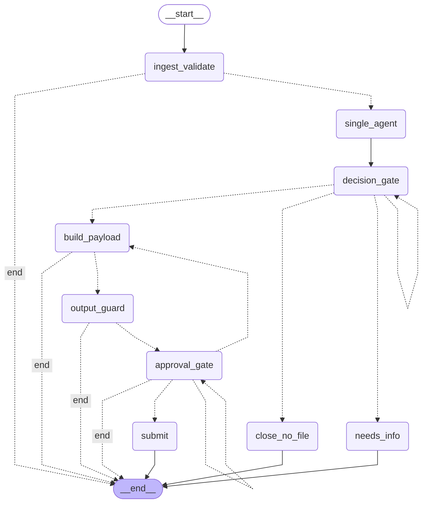

<!-- Generated by scripts/export_graphs.py (make docs-evidence). Do not edit. -->
# Graph: C1 single agent (`auditguard/graph/single_agent.py`), spec in docs/03 §2

Drawn by LangGraph from the compiled graph. Dotted edges are conditional.

